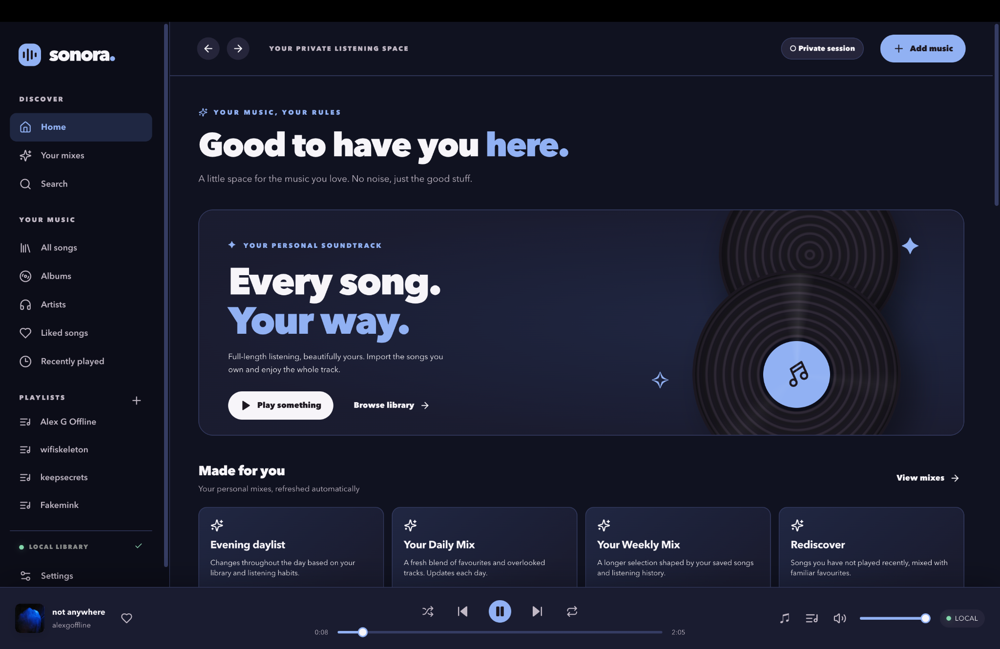

# Sonora Music

An independent macOS music player for your own local music collection, featuring dynamic album-art colour themes, a light/dark appearance studio, music-library management, media controls, and an optional local-network phone companion.

**Version 0.3.0 — Better playlists and library search (29 October 2026)**


## Your album art, your atmosphere

Sonora automatically samples the **colours in the current song's album artwork** and carries a coordinated palette across the interface — including the background, sidebar, highlighted controls, playlist cards and music player. The colours change as the song changes, creating a different listening space for every cover.

| Blue tones | Golden tones | Rose tones |
|:---:|:---:|:---:|
|  |  |  |

*Three songs, three colour palettes — all generated from their album covers, not preset theme colours.* Choose **Automatic**, **Light** or **Dark** in **Settings → Appearance** to control how those artwork colours are expressed. Palette extraction happens locally on your Mac.


## What's new in v0.3.0

Create playlists directly from songs you have **already imported**: no need to import audio files again. Search by song, artist or album; select all matches, select individual songs, or drag over consecutive rows to select or deselect a range. Search results show compact embedded album-art thumbnails alongside track details, with a fallback icon when artwork is missing.

- **Smarter search:** typing `alexg`, `Alex G` or `ALEX-G` matches `Alex G` and `alexgoffline` because spacing, case and punctuation are normalised. The same search logic works in the main library and in the playlist picker.
- **Safe keyboard controls:** pressing Enter inside the picker search no longer submits or closes the dialog. Individual checkboxes remain clickable and keyboard accessible.
- **Manage playlists:** add and remove saved library tracks, reorder selections, rename playlists and retain edits across app restarts. Bulk selection doesn't lose choices when the query changes.
- **Regression-tested:** isolated Electron tests cover drag selection, artist search, album covers, editor behaviour, playlist persistence, storage failures, keyboard navigation, audio import and playback. Tests use synthetic data; your library isn't copied into the repository.

The existing album-aware Automatic / Light / Dark appearance modes remain available in **Settings → Appearance**, with on-device artwork-derived colours and reduced-motion support.

### Other features

- Local-folder library scanning for MP3, M4A/AAC, WAV, FLAC, OGG and other supported formats; music stays in its original folder.
- Search, favourites, playlists, queue reordering and metadata edits.
- Play/pause, skip, keyboard and native macOS media controls.
- Equaliser presets, adjustable crossfade and a lyrics interface when available.
- Optional phone companion over your local Wi-Fi, including PS5 Gaming Remote controls for music played on the Mac (not PS5 music playback).
- No commercial streaming catalogue or music downloads.

## Install and run

The app targets Apple Silicon macOS and is **unsigned and not notarised**. Download the packaged app from [GitHub Releases](https://github.com/buzzword365/sonora-music/releases), unzip it and open **Sonora Music.app**. macOS may require a manual approval in Privacy & Security.

Back up your previous app before replacing it. Sonora stores its library, playlists and settings in your user's application-data directory rather than inside the app bundle. Keep your original music files in place.

## Build from source

The editable **React + TypeScript source is included** in this repository (unlike the initial public release).

Prerequisites: Node.js 24+, npm, macOS and the usual Apple build tools.

```sh
git clone https://github.com/buzzword365/sonora-music.git
cd sonora-music
npm ci
npm run dev             # Vite UI development server
npm run build           # Type-check and compile the renderer
npm run check           # Check native Electron scripts
npm run test:palette    # Colour and accessibility regression tests
npm run test:playlists  # Synthetic-library playlist, search and drag tests
npm run pack:mac        # Package the macOS app
npm run test:package    # Smoke-test the packaged app
```

Run `npm start` to open the built Electron desktop app, or `npm run desktop:dev` alongside `npm run dev` to work on the UI. An optional isolated-profile Electron UI test can be run with `npm run test:e2e`; it uses synthetic fixture tracks and tests the theme transitions and persistence.

## Source layout

| Path | Role |
|---|---|
| `src/artworkTheme.ts` | Album-art sampling, colour clustering, light/dark palettes and contrast adjustment |
| `src/artwork-theme.css` | Component colours, transitions and illustrated appearance selector |
| `src/App.tsx` | App interface, settings and playback |
| `src/store.ts` | On-device music metadata and preferences |
| `src/audioMixer.ts` | Audio mixing, equaliser and crossfading |
| `electron/` | Native desktop host, secure media access, local phone companion |
| `src/PlaylistEditor.tsx` | Playlist picker, multi-select and drag-to-select interactions |
| `src/librarySearch.ts` | Normalised library and picker search |
| `tests/` | Synthetic, isolated Electron UI and palette regressions |
| `dist/` | Precompiled renderer for convenience |

## Privacy and distribution

No personal tracks, album-cover collections, listening history, playlists, account tokens, music-folder indexes, or runtime phone pairing credentials are checked in. The phone companion uses your local network and should only be paired on a network you trust; it is not a remote internet music service. Source files are editable under the repository's MIT licence, subject to third-party notices in [THIRD_PARTY.md](THIRD_PARTY.md).

Sonora is an independent personal project, not an official Apple Music or Spotify application.
